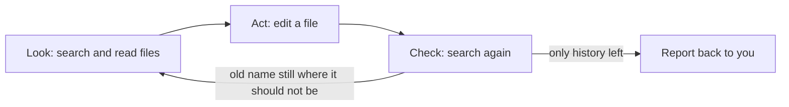

# Lab 01: How an agent works: answer versus act

## Goal

Give Copilot one everyday job twice: first as a question, then as a task. Your team's product, Orders Hub, has
been renamed Order Desk, and its documents still use the old name. Asked a question, Copilot tells you where the
old name appears and leaves the files alone. Given the task, the agent searches the folder, edits the files, leaves
the history untouched and searches again to check its own work. That cycle of look, act and check is what makes it
an agent. You then check the result yourself with VS Code's search.

## What you will learn

- Tell a request that answers apart from one that acts, and pick the mode for each.
- Write a short task with three parts: the goal, a limit and a check.
- Follow the agent's steps in the chat: what it searched, read, changed and checked.
- Check the result yourself and roll back a change you do not want.

## Before you start

You need VS Code with GitHub Copilot signed in ([Lab 00](../00_Setup_Check/) checks this). Nothing else to install,
and no coding.

1. In VS Code choose **File > Open Folder** and open the `project` folder inside this lab
   (`01_How_An_Agent_Works/project`). Keep this README open somewhere else, for example on GitHub in your browser.
   Copilot then works only on the team documents, not on the lab text.
2. If VS Code asks whether you trust the authors of the folder, choose to trust it. It holds only text files.
3. Open the Chat view and start a **New Chat**.

The project is a small set of team documents:

| File | What it is |
|---|---|
| `README.md` | What Orders Hub is and who uses it |
| `guides/getting-started.md`, `guides/exporting-reports.md` | Two how-to guides |
| `faq.md`, `onboarding-checklist.md` | Questions and a checklist for new staff |
| `templates/welcome-email.txt` | The email new users receive |
| `CHANGELOG.md` | What changed in each past release |
| `support/customer-message-2026-04.md` | A customer's message, kept as written, and the team's reply |

## Part A: Look at the job yourself

Before you ask Copilot anything, find the right answer yourself, so you can judge Copilot's.

1. Open search across files: **Edit > Find in Files** (Ctrl+Shift+F on Windows and Linux, Cmd+Shift+F on Mac).
2. Type `Orders Hub`. VS Code finds **18 results in 8 files**. With **Match Case** off (the default) it also finds
   "The orders hub" in the getting-started guide.
3. Read the results and decide which ones should change. Two kinds should keep the old name:
   - The three past entries in `CHANGELOG.md`. Those releases happened under the old name; rewriting them changes
     the record.
   - The quoted customer message. Those are the customer's words. The team's reply underneath is ours and should
     change.
4. Expand the search box with the small arrow on its left to show **Replace**. Type `Order Desk`, but do **not**
   select Replace All. Look at the preview: Replace All would change all 18, history included.

Checkpoint: 18 results in 8 files; 14 should change and 4 should stay. A find-and-replace treats every match the
same. This job needs a decision on each one.

## Part B: Ask a question

This part shows what Copilot does when you ask for an answer.

1. In the chat's mode picker choose **Plan**. Plan mode is made for research before any change: it reads and
   searches your files and reports back. (On a Local session the picker may offer **Ask** instead; use that.)
2. Paste this request:

   ```text
   Our product Orders Hub has been renamed Order Desk. Where does the old name
   appear in this folder, and which mentions should keep the old name?
   Don't change anything.
   ```

3. While it works, expand the steps in the chat. You will see it search for the name and open files.

What to look for:

- It lists the files that mention Orders Hub. Compare with your 8 from Part A.
- It names the changelog entries and the customer's quote as history, or asks you about them.
- No file changed. "Don't change anything" guides the agent; it is not a lock. [Lab 06](../06_Agent_With_Limits/)
  shows how to make one.

Checkpoint: you have a list, and you would now do the 14 edits yourself. That is the assistant way of working:
Copilot answers, you act.

## Part C: Hand over the task

Same job, but now the agent does it and checks it.

1. Switch the mode picker to **Interactive**, the mode where the agent can edit files. (On a Local session choose
   **Agent**.)
2. Paste this task:

   ```text
   Rename Orders Hub to Order Desk in this folder.
   Keep the old name where it is history: past changelog entries and the customer's quoted message.
   When you finish, search again and tell me every place the old name is left.
   ```

   The three lines are the goal, the limit and the check. You will reuse this shape in every lab.

3. Watch the steps as they appear. The agent repeats a short cycle until the job is done:



What to look for:

- **Look:** a search for "Orders Hub", then the files it opens.
- **Act:** an edit per file. Open the changed files the chat lists (or **View All File Changes**) to see each
  diff: red lines removed, green lines added.
- **Check:** a second search at the end, because your third line asked for it.
- **Report:** where the old name is left, and why.

Checkpoint: the report lists 4 places left: three in `CHANGELOG.md` and one in the customer's quote. Seven files
changed; `CHANGELOG.md` did not.

## Part D: Check the work yourself

The agent says it is done. You decide whether it is.

1. Search for `Orders Hub` again. Expect **4 results in 2 files**: the three changelog entries and the quote.
2. Search for `Order Desk`. Expect **14 results in 7 files**. Open two of them and read the sentence: the agent had
   to handle "Orders Hub's export" and the lowercase "The orders hub remembers" so the sentences still read well.
3. Search for `orders-hub`. You find the chat channel **#orders-hub-help** four times. Your search for the name
   with a space did not catch it, and your task did not mention it. Did the agent change it? A document cannot
   rename a chat channel; if the channel still has its old name, a new channel name in the documents sends people
   nowhere. The safe choice is to keep it and ask whoever owns the channel. If the agent changed it, roll it back
   (next step) or edit it back by hand.
4. To roll back a whole request, hover over your request in the chat and select **Restore Checkpoint**. VS Code
   puts the files back as they were before that request. On a Local session you can also select **Keep** or
   **Undo** for each file.

Checkpoint: 4 old-name results left, 14 new-name results, and you made a decision about the channel name. You
checked the result with your own search, not with the agent's report.

## If your run looks different

| What you see | What to do |
|---|---|
| No **Plan** or **Interactive** in the mode picker | Your session type offers different names. Use **Ask** for Part B and **Agent** for Part C |
| The agent renamed the changelog entries or the quote | Restore the checkpoint and send the task again. Your own search in Part D caught it; that is why you check |
| It stopped without a final search | Ask: `Search again and list every place the old name is left.` |
| It asks you a question, for example about the channel | A good sign. Answer it: keep the channel name as it is |
| In Part B it changed files anyway | Restore the checkpoint. A request to change nothing is guidance; Lab 06 shows a real limit |
| Your counts differ from 18, 14 and 4 | Copy a fresh `project` folder from the repo; an earlier run may have changed it |

## What you can do now

- Tell an answer request from a task, and choose Plan or Interactive for each.
- Write a task with a goal, a limit and a check, as in Part C.
- Read the agent's look, act and check steps in the chat and open each file's diff.
- Check the result with your own search and roll back with Restore Checkpoint.

## Challenge

1. Restore the checkpoint from Part C and send the task without its second line (the limit). Search for
   `Orders Hub` afterwards. Expected: the changelog entries and the quote are likely renamed too. The limit was
   what protected them.
2. Give the agent a new task on the renamed folder: add a line to the top of `README.md` that says Orders Hub is
   now called Order Desk, and a changelog entry dated today that records the rename. Write it with a goal, a limit
   and a check. Expected: one new changelog entry at the top, the past entries unchanged, and the README line in
   place.

Answers to compare with when you finish: [`solved/`](solved/) holds the folder after a correct Part C.

## Going further

- **Autopilot.** The mode picker also offers Autopilot, which carries on with fewer pauses for your approval. Use it
  only when your check is strong, and compare what you had to approve with Part C.
- **Checkpoints.** Each request gets a checkpoint, so you can try a task, look at the result and roll back. Restoring
  does not undo commands the agent ran in the terminal; Lab 06 covers approving those.

## Resources

- [What an agent is in VS Code](https://code.visualstudio.com/docs/agents/concepts/agents)
- [Plan before you build](https://code.visualstudio.com/docs/agents/run/planning)
- [Review the agent's edits and use checkpoints](https://code.visualstudio.com/docs/agents/run/review-code-edits)
- [Search across files in VS Code](https://code.visualstudio.com/docs/editing/codebasics#_search-across-files)
