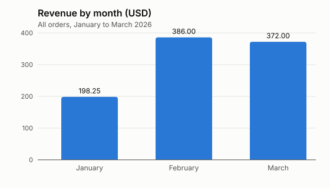

# Leaf & Pot: sales report, January to March 2026

**Total revenue: 956.25 USD from 40 orders.**

## Revenue by month

| Month | Revenue (USD) |
|---|---:|
| January | 198.25 |
| February | 386.00 |
| March | 372.00 |

March was down 3.6% on February (386.00 to 372.00).

## Revenue by product

| Product | Units | Revenue (USD) |
|---|---:|---:|
| Gift box | 8 | 276.00 |
| Herbal tea 100 g | 31 | 209.25 |
| Green tea 100 g | 23 | 195.50 |
| Teapot | 6 | 174.00 |
| Black tea 100 g | 14 | 101.50 |

Gift box brought in the most revenue (276.00 USD).

Source: `data/orders-2026-q1.csv`.
