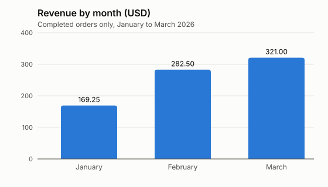

# Leaf & Pot: sales report, January to March 2026

**Total revenue: 772.75 USD from 37 completed orders.**

3 cancelled orders, worth 183.50 USD, are left out of every number in this report.

## Revenue by month

| Month | Revenue (USD) |
|---|---:|
| January | 169.25 |
| February | 282.50 |
| March | 321.00 |

March was up 13.6% on February (282.50 to 321.00).

## Revenue by product

| Product | Units | Revenue (USD) |
|---|---:|---:|
| Herbal tea 100 g | 31 | 209.25 |
| Gift box | 5 | 172.50 |
| Teapot | 5 | 145.00 |
| Green tea 100 g | 17 | 144.50 |
| Black tea 100 g | 14 | 101.50 |

Herbal tea 100 g brought in the most revenue (209.25 USD).

Source: `data/orders-2026-q1.csv`.
