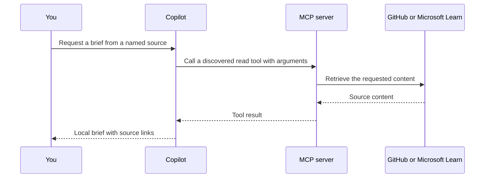

# Bonus: How to connect Copilot to an external source with MCP

## Goal

Connect Copilot to an MCP server, use one of its read tools, and turn the returned source into a local brief you
can check. The important moment is seeing a named server tool return the issue or documentation behind the answer.
A correct answer alone does not establish which connection the agent used.

## What you will learn

- Add a workspace MCP configuration and inspect the tools the server exposes.
- Restrict a GitHub connection to reading an issue.
- Separate server discovery, a tool call and a source-supported answer.
- Recognize unavailable access and use a labelled alternative without inventing a live result.

## Before you start

This is optional practice after [Lab 00](../00_Setup_Check/). You need VS Code, Copilot and an internet connection.
There is no Python, Docker, package installation or application build. The GitHub route needs an account and an
organisation policy that permits the official GitHub MCP server. If it is blocked, the Microsoft Learn route
uses public documentation without authentication; your organisation must permit that server too. Copilot model
usage still counts toward your allowance.

1. Open this lab's `project` folder as its own workspace. Keep this guide and its resources open elsewhere.
2. Read `task.md`. It names a real public issue. Do not create an issue or use a private repository for this lab.
3. Start a New Chat in Interactive mode (or Agent in a Local session), with Manual permissions.
4. Review the configuration in Part B before you create it. Starting a server can involve trust or authentication
   prompts. Check the publisher, address and requested access rather than accepting an unrelated sign-in.

The project holds only `README.md` and `task.md`. To start over, use an untouched copy of `project`. Keep completed
copies with their chats if you want a record of the source and retrieval date.

## Part A: Decide what the external source must supply

**MCP**, the Model Context Protocol, lets a client such as Copilot discover tools from another service and call
them. A tool has a name, input arguments and a returned result. GitHub's server can read issues; Microsoft's Learn
server can search and fetch documentation. Their tools are different even though they use the same protocol.



1. Open the issue link from `task.md` in your browser. Read its title, body and state yourself. It is a historical
   request about porting a CLI server; it may already be closed.
2. Write down three requirements from the body. Keep your suggested tests separate: the issue does not provide
   a complete test matrix. Do not give your notes to Copilot yet.
3. Predict what evidence would distinguish an MCP read from an answer based on memory: the named server tool,
   its repository/issue arguments and the returned issue body.

Checkpoint: you have an answer to compare with and know which tool result you need to inspect. A browser read is
useful for your check; it is not the agent's MCP tool call.

## Part B: Configure one server

Use the portable workspace format recommended by the
[VS Code MCP documentation](https://code.visualstudio.com/docs/agent-customization/mcp-servers).
Create `.mcp.json` directly inside the opened `project` folder. This file uses a top-level `mcpServers` object.
The older `.vscode/mcp.json` format uses `servers`; do not mix the two shapes.

1. Copy the contents of [resources/github-mcp.json](resources/github-mcp.json) into `.mcp.json`. Open it and
   inspect the address and headers:

   ```json
   {
     "mcpServers": {
       "github": {
         "type": "http",
         "url": "https://api.githubcopilot.com/mcp/",
         "headers": {"X-MCP-Tools": "issue_read", "X-MCP-Readonly": "true"}
       }
     }
   }
   ```

2. Open **Configure Chat > MCP Servers**, or run **MCP: List Servers** from the Command Palette. Start the GitHub
   server if needed. Complete GitHub sign-in only through the official flow your organisation permits. No token
   belongs in this JSON file or in a chat message.
3. Open **Configure Tools** in the chat input. Find the GitHub server and its issue read tool. Keep that tool
   available; turn off unrelated GitHub servers or write tools for this request if any were already selected.
4. Check the server configuration still contains read-only mode. It filters write tools on this server. It does
   not change other servers, terminal access or the permissions of your GitHub account.

Checkpoint: the server is running and an issue read tool is available. Authentication alone is not enough.
If policy or sign-in blocks this route, take the alternative below; do not remove organisation controls.

### Alternative: Microsoft Learn documentation

Use this instead of the GitHub route when its access is unavailable. Replace `.mcp.json` with
[resources/learn-mcp.json](resources/learn-mcp.json), which points to `https://learn.microsoft.com/api/mcp`.
Start **microsoft-learn** and look for `microsoft_docs_search` and `microsoft_docs_fetch` in Configure Tools.
Microsoft documents this as a public server with no authentication. Choose only these tools for the request.
You will create `briefs/learn-mcp.md` rather than an issue brief. This exercises the same discovery/call/check
sequence with a different source and outcome.

## Part C: Call a tool and inspect its result

Keep the request small so you can compare its answer directly with the source.

1. For the GitHub route, send:

   ```text
   Use the GitHub MCP issue read tool to read github/github-mcp-server issue 1, including its body.
   Write briefs/issue-1.md with its URL, number/title, observed state and retrieval date,
   three requirements from the body, proposed checks and open questions in separate sections.
   Leave GitHub unchanged. If that MCP tool is unavailable, report the gap and stop.
   ```

   For the Microsoft Learn alternative, send this instead:

   ```text
   Use the Microsoft Learn MCP search tool to find the Microsoft Learn MCP Server overview, then fetch it.
   Write briefs/learn-mcp.md with its endpoint, transport and authentication requirements,
   each supported by a source link, plus a separate proposed verification step and retrieval date.
   If those MCP tools are unavailable, report the gap and stop.
   ```

2. Expand the chat's steps. Find a tool call under your selected server. For GitHub, inspect the repository,
   issue number and method that retrieves the body. For Learn, inspect the query, returned URL and fetch call.
   Approve a requested read only after checking that it names the intended public source.
3. Read the returned content before opening the brief. A generic web fetch, a different installed GitHub
   connector or a statement such as “I used MCP” is insufficient evidence for this particular connection.
4. If no MCP call happened, say `The steps show no call to the configured MCP server. Use its read tool or report
   it unavailable.` Do not keep retrying a server that policy forbids.

Checkpoint: you can point to discovery in the tool picker, the actual call and its returned source separately.
Your runtime may prefix tool names with the server name. Check the server identity and arguments, not just a label.

## Part D: Check the brief against the source

A retrieved source can still be summarized incorrectly. Use the notes you made before the agent started.

1. Open the brief. Check its URL, title and factual claims against the returned source and your browser copy.
2. For issue 1, expect the port into GitHub's official project, continuity of existing workflows, and local
   execution with the earlier function coverage. The prepared snapshot's state is closed. A current state can
   differ; check live evidence rather than replacing it with the snapshot.
3. Check that suggested tests are labelled as proposals. The body does not specify the exact earlier revision,
   every required runtime or a complete migration checklist. Those belong under questions unless another source
   answers them.
4. For Learn, expect the endpoint above, Streamable HTTP and no authentication. Open each supporting link. If a
   sentence has no support, ask for a source or have it moved to the proposed section.

Checkpoint: the brief distinguishes source facts from your implementation ideas. Nothing on GitHub changed.
An issue's closed state does not mean your session implemented or tested it.

## If your run looks different

| What you see | What to do |
|---|---|
| The server is absent | Check `.mcp.json` is at the opened workspace root and has `mcpServers`; reload the window |
| Sign-in or policy blocks GitHub | Try the Learn route if permitted, or the offline route below |
| Server starts but the tool is absent | Check Configure Tools, read-only configuration and **MCP: List Servers > Show Output** |
| The answer came from a browser tool | Label that route accurately, then request the configured MCP tool or record it unavailable |
| Tool returns an error | Read the server output and arguments; do not turn an error into an invented source |

If both live routes are unavailable, use [the prepared snapshot](resources/issue-snapshot.md) for the brief and
label it **offline snapshot, not live MCP**. This still practices checking source claims. It does not complete the
connection checkpoint. When finished, stop the lab server in **MCP: List Servers** and remove its workspace
configuration if you no longer want it available.

## What you can do now

- Configure a workspace MCP server and find its advertised tools.
- Request a narrow read operation and recognize the access it actually provides.
- Check discovery, execution and answer quality separately.
- Report an unavailable connection honestly and distinguish a prepared fallback from a live result.

## Challenge

1. Stop the lab server and make its tools unavailable in Configure Tools. Move earlier briefs outside the
   workspace, close their tabs, then start a New Chat and repeat the same request. Expected: an access gap and
   no claim of live MCP retrieval. If it uses another connector, identify that separate route. Restore the server
   and tools before another live run.
2. Add one more implementation question to the brief. Expected: either a cited source answers it, or it remains
   explicitly unanswered. Do not turn a proposed design choice into a requirement from the issue.

Prepared answers: [`solved/`](solved/).

## Going further

A team can combine a briefing skill with an MCP connection: the skill supplies the method; the server supplies
external tools and data. Review both. A skill's instruction to read only is guidance; server-side read-only mode
and the exposed tools provide a separate access control. Add remote write workflows only when you have a suitable
repository and an explicit reason to create or change its records.

## Resources

- [VS Code MCP servers](https://code.visualstudio.com/docs/agent-customization/mcp-servers)
- [Official GitHub MCP server configuration](https://github.com/github/github-mcp-server/blob/main/docs/server-configuration.md)
- [Microsoft Learn MCP overview](https://learn.microsoft.com/en-us/training/support/mcp)
- [Model Context Protocol](https://modelcontextprotocol.io/docs/getting-started/intro)
